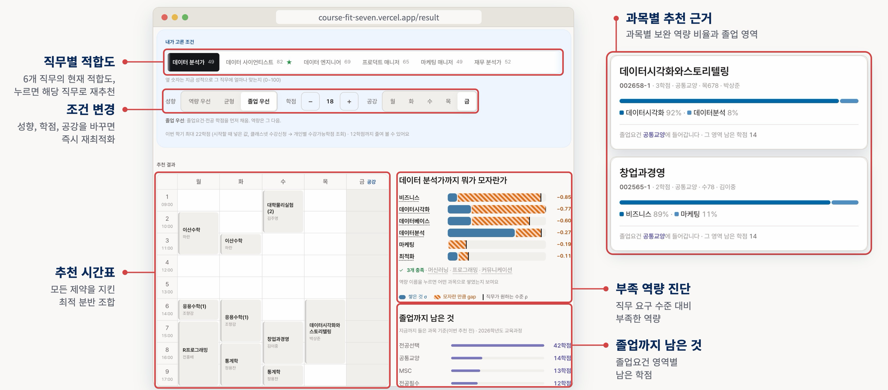
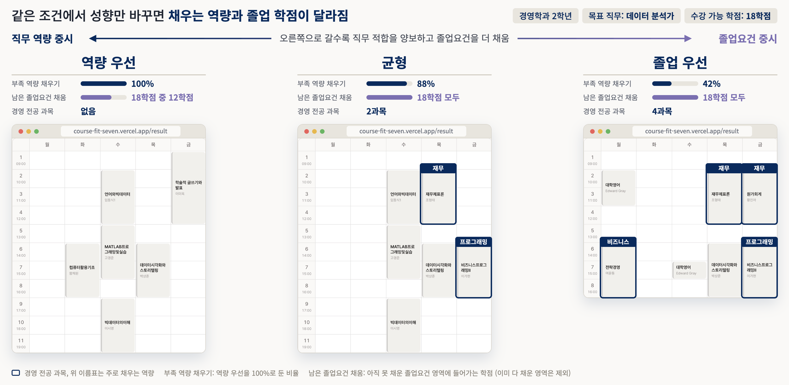
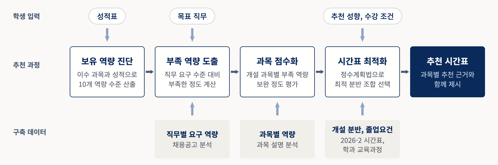
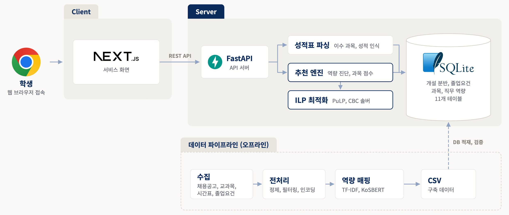

# 🎓 Course Fit

**[서비스 바로가기 →](https://course-fit-seven.vercel.app)**

진로 목표와 수강 조건을 고려한 **개인 맞춤형 홍익대학교 시간표 추천 시스템**  
이수 과목과 성적으로 현재 역량을 진단하고, 목표 직무에 부족한 역량과 졸업요건을 함께 채우는 다음 학기 시간표를 추천합니다.

---

## 📖 문제 정의 및 해결 방향

수강신청은 졸업과 진로를 함께 좌우하지만, 필요한 정보가 흩어져 있어 학생이 혼자 판단하기 어렵습니다.

| 구분 | 현재 상황 | Course Fit|
|---|---|---|
| **졸업요건** | 영역별 남은 학점을 직접 계산 | 영역별 부족 학점을 계산해 반영 |
| **진로 역량** | 목표 직무에 필요한 역량과 내 수준을 알기 어려움 | 성적표로 역량을 진단하고 부족한 역량을 채우는 과목 추천 |
| **시간 제약** | 시간 충돌, 학점, 공강을 직접 조합 | 조건을 지키는 신청 가능한 조합만 추천 |

## 🖥️ 서비스 화면

**추천 시간표와 근거**

<p align="center">
  
</p>

**추천 성향별 시간표 비교**

<p align="center">
  
</p>

## ✨ 주요 기능

- **성적표 붙여넣기**: 클래스넷 「전체성적조회」 화면을 복사해 넣으면 이수 과목과 성적을 읽습니다. 로그인과 개인정보 수집이 없고, 넣은 성적표는 24시간 뒤 삭제됩니다.
- **목표 직무 6종**: 지금 성적으로 각 직무에 얼마나 맞는지(0~100) 함께 보여 줍니다.
- **추천 성향 3가지**: 역량 우선, 균형, 졸업 우선 중에서 고릅니다.
- **수강 조건**: 이번 학기 최대 학점과 공강 요일을 고르면 그 안에서 추천합니다.
- **추천 근거**: 과목마다 어떤 역량을 얼마나 채우는지, 어느 졸업요건 영역에 들어가는지 보여 줍니다.
- **대안 시간표**: 가장 좋은 안과 함께 차선 두 가지를 보여 주고 무엇이 다른지 알려 줍니다.

## ⚙️ 동작 원리

<p align="center">
  
</p>

1. **보유 역량 진단**: 이수 과목과 성적으로 10개 역량의 보유 수준을 계산합니다.
2. **부족 역량 도출**: 채용공고에서 뽑은 직무별 요구 수준과 비교해 부족한 정도를 구합니다.
3. **과목 점수화**: 이번 학기 개설 과목마다 부족 역량을 얼마나 채우는지 점수를 매깁니다.
4. **시간표 최적화**: 정수계획법(ILP)으로 조건을 모두 지키는 최적 분반 조합을 고릅니다.  
   시간 충돌, 학점 범위, 기수강, 선수과목, 수강 학년, 공강 조건에 맞지 않는 분반은 추천되지 않습니다.

**추천 성향**은 1순위인 직무 적합을 정해진 폭(ε) 안에서 지키면서, 2순위인 졸업요건을 최대한 채우는 방식(사전식 최적화)입니다.

| 추천 성향 | ε | 직무 적합 유지 |
|---|:---:|---|
| 역량 우선 | 0 | 100% |
| 균형 | 0.3 | 70% 이상 |
| 졸업 우선 | 0.6 | 40% 이상 |

## 🗂️ 데이터

| 데이터 | 출처 | 규모 |
|---|---|---|
| **직무별 요구 역량** | 채용공고 (채용 플랫폼, 기업 채용 페이지, 공공기관 등) | 95곳, 3,826건 |
| **과목별 역량** | 홍익대학교 교과목 (2020~2026년 전 학과) | 3,389과목 |
| **개설 분반** | 홍익대학교 2026-2 공식 시간표 | 278과목, 927분반 |
| **졸업요건** | 2026 교과과정 책자 | 산업데이터공학과 2026, 경영학과 2022 |

과목 설명과 채용공고를 같은 10개 역량으로 점수화합니다.  
프로그래밍, 데이터 분석, 머신러닝, 데이터베이스, 데이터 시각화, 비즈니스, 재무, 마케팅, 최적화, 커뮤니케이션

> **역량 점수 = 0.7 × TF-IDF + 0.3 × KoSBERT 유사도**

## 🧱 시스템 아키텍처

<p align="center">
  
</p>

| 구분 | 기술 |
|---|---|
| **Frontend** | Next.js 15, React 19, TypeScript, Tailwind CSS v4 |
| **Backend** | Python 3.12, FastAPI |
| **Optimization** | PuLP (CBC 솔버), 정수계획법 (ILP) |
| **Database** | SQLite |
| **Data Pipeline** | Python (개설 과목, 졸업요건, 채용공고 수집과 역량 매핑) |
| **Infra / Deploy** | Vercel (Frontend), Render (Backend), Docker, GitHub Actions |

## 📌 지원 범위

| 항목 | 범위 |
|---|---|
| **학과, 학번** | 경영학과 (22학번~), 산업데이터공학과 (26학번~) |
| **개설 학기** | 2026학년도 2학기 (278과목, 927분반) |
| **직무** | 데이터 분석가, 데이터 사이언티스트, 데이터 엔지니어, 프로덕트 매니저, 마케팅 매니저, 재무 분석가 |
| **학점** | 한 학기 12학점 ~ 학생이 고른 상한 학점 (최대 이수학점) |

## 🔭 확장 가능성

- **학기 갱신**: 새 학기가 열리면 해당 학기의 개설 과목 데이터를 추가해 그대로 추천할 수 있습니다.
- **지원 학과 확장**: 학과별 졸업요건과 개설 과목 데이터를 추가해 대상 학과를 넓힙니다.
- **지원 직무 확장**: 채용공고 기반 요구 역량을 추가해 목표 직무를 늘립니다.

## 📂 디렉터리 구조

```text
course-fit/
├── web/                  프론트엔드 (Next.js)
├── api/                  API 서버 (FastAPI), 추천 엔진 HTTP
│
├── recommender/          시간표 추천 엔진 (ILP 최적화)
├── transcript/           성적표 텍스트 파싱과 적재
├── mapping/              과목, 채용공고를 역량으로 매핑
├── crawlers/             졸업요건, 개설 과목, 채용공고 수집
│
├── db/                   스키마와 적재 스크립트
├── data/                 수집, 매핑 산출물 CSV
├── tests/
└── docs/                 설계 문서
```

---

## 🧑‍💻 팀
2026년 홍익대학교 산업데이터공학과 졸업 프로젝트

<table>
  <tr><th align="center">팀원</th><th align="center">역할</th><th align="center">담당 기능</th></tr>
  <tr>
    <td rowspan="4" align="center"><br><a href="https://github.com/soyeoneeii">@soyeoneeii</a></td>
    <td align="left">DB 스키마 설계 및 구축</td>
    <td align="left">학과, 과목, 졸업요건 데이터 모델 정의</td>
  </tr>
  <tr>
    <td align="left">과목-직무 역량 매핑</td>
    <td align="left">과목과 직무를 역량으로 매핑하는 파이프라인 구축</td>
  </tr>
  <tr>
    <td align="left">추천 엔진 구현</td>
    <td align="left">ILP 추천 모델 설계와 구현 [기본] 추천 성향, 대안 시간표 [고도화] 학점, 공강 조건</td>
  </tr>
  <tr>
    <td align="left">백엔드 서버 개발, 배포</td>
    <td align="left">API 서버, 배포 컨테이너화 (Docker)</td>
  </tr>
  <tr>
    <td rowspan="3" align="center"><br><a href="https://github.com/yeongjunyoo">@yeongjunyoo</a></td>
    <td align="left">데이터 수집 및 전처리</td>
    <td align="left">채용공고, 개설 과목 수집, 직무 6종 선정, 성적표 파싱</td>
  </tr>
  <tr>
    <td align="left">프론트엔드 개발</td>
    <td align="left">웹 화면 설계, UI/UX 고도화, 배포 자동화 (GitHub Actions)</td>
  </tr>
  <tr>
    <td align="left">추천 엔진 개선</td>
    <td align="left">[고도화] 수강 학년 제약, 동점 결정 규칙, 졸업 우선 영역 가중</td>
  </tr>
</table>
