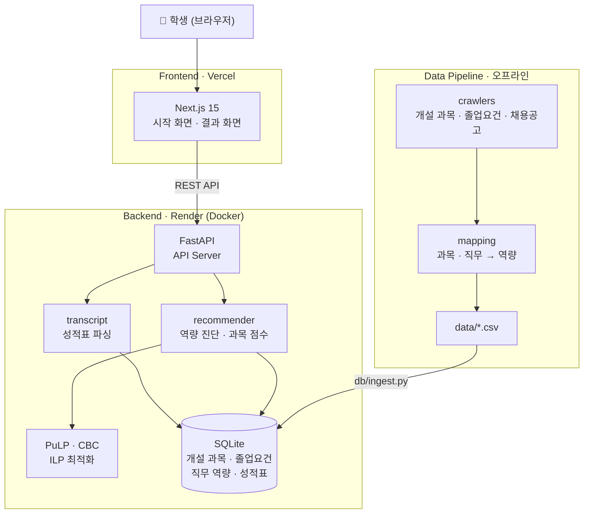
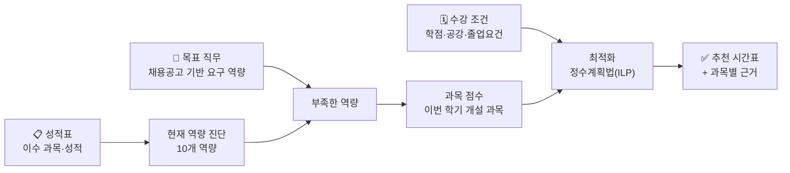

# 🎓 Course Fit
https://course-fit-seven.vercel.app  
진로 목표와 수강 조건을 고려한 **개인별 맞춤형 홍익대학교 시간표 추천 시스템**  
이수 과목과 성적으로 현재 역량을 분석하고, 목표 직무에 필요한 역량을 보완하는 시간표를 추천합니다.  

---

## 📖 프로젝트 소개

Course Fit은 이수 과목과 성적을 바탕으로 **학생의 현재 역량을 분석**하고, **목표 직무에 필요한 역량을 보완하는 시간표**를 추천하는 서비스입니다. 교과목과 직무 데이터를 연계하고 수리최적화를 활용해 졸업 요건과 수강 조건, 공강 등 개인의 선호를 함께 고려합니다. 추천된 각 과목이 어떤 역량을 보완하는지 근거를 제시하여, 학생이 자신의 진로와 상황에 맞는 학업 계획을 세우도록 돕습니다.  

<!-- TODO: 화면 캡처 2~3장 (시작 화면, 결과 화면). 이미지는 docs/images/ 에 두고 여기에 넣는다 -->

## 🚀 Tech Stack

| Category | Stack |
|---|---|
| **Frontend** | Next.js 15, React 19, TypeScript, Tailwind CSS v4 |
| **Backend** | Python 3.12, FastAPI |
| **Optimization** | PuLP (CBC 솔버), 정수계획법 (ILP) |
| **Database** | SQLite |
| **Data Pipeline** | Python (개설 과목·졸업요건·채용공고 수집, 역량 매핑) |
| **Infra / Deploy** | Vercel (Frontend), Render (Backend), Docker, GitHub Actions |

## 🧱 Architecture



## ✨ 주요 기능

| 구분 | 주요 기능 |
|---|---|
| **성적표 입력** | 클래스넷 「전체성적조회」 화면을 복사해 붙여넣으면 이수 과목과 성적을 읽습니다. 로그인이 없고 학번·이름을 수집하지 않으며, 넣은 성적표는 24시간 뒤 서버에서 삭제됩니다. |
| **목표 직무 6종** | 데이터 분석가, 데이터 사이언티스트, 데이터 엔지니어, 프로덕트 매니저, 마케팅 매니저, 재무 분석가. 지금 성적으로 각 직무에 얼마나 맞는지(0~100)를 함께 보여 줍니다. |
| **추천 성향 3가지** | 역량 우선, 균형, 졸업 우선. 부족한 역량을 채우는 것과 졸업요건을 채우는 것 가운데 어느 쪽에 무게를 둘지 고릅니다. |
| **수강 조건 반영** | 이번 학기에 담을 최대 학점과 비워 둘 요일(공강)을 고르면 그 안에서 추천합니다. |
| **신청 가능한 시간표만** | 시간이 겹치는 과목, 이미 들은 과목, 선수과목을 안 들은 과목, 수강 학년이 안 맞는 분반은 처음부터 후보에서 빠집니다. |
| **추천 근거 제시** | 과목마다 어떤 역량을 얼마나 보완하는지, 어느 졸업요건 영역에 들어가는지 보여 줍니다. |
| **대안 시간표** | 가장 좋은 안과 함께 차선 두 가지를 보여 주고 무엇이 다른지 알려 줍니다. |

---

## ⚙️ 동작 원리



1. **현재 역량 진단**: 이수한 과목과 성적으로 10개 역량(프로그래밍, 데이터분석, 머신러닝, 데이터베이스,
   데이터시각화, 비즈니스, 재무, 마케팅, 최적화, 커뮤니케이션)의 보유 수준을 계산합니다.
2. **직무와의 차이**: 채용공고에서 뽑은 직무별 요구 역량과 견주어 부족한 역량을 찾습니다.
3. **과목 점수**: 이번 학기 개설 과목마다 그 부족한 역량을 얼마나 채워 주는지 점수를 매깁니다.
4. **최적화**: 시간 충돌, 학점 범위, 기수강, 선수과목, 공강을 제약으로 두고 정수계획법(ILP)으로 풉니다.
   1순위로 직무 적합을 최대화하고, 그 수준을 정해진 폭 안에서 지키면서 2순위로 졸업요건 진척을
   최대화합니다. 그 폭을 정하는 것이 추천 성향입니다.


## 📌 지원 범위

| 항목 | 범위 |
|---|---|
| 학과·학번 | 경영학과 (22학번~), 산업데이터공학과 (26학번~) |
| 개설 학기 | 2026학년도 2학기 (과목 3,389개, 분반 927개) |
| 직무 | 6종 (데이터 분석가, 데이터 사이언티스트, 데이터 엔지니어, 프로덕트 매니저, 마케팅 매니저, 재무 분석가) |
| 학점 | 한 학기 12학점 ~ 학생이 고른 상한 학점 (최대 이수학점) |

## 🔭 확장 가능성

- **학기 갱신**: 새 학기가 열리면 해당 학기의 개설 과목 데이터를 추가해 그대로 추천할 수 있습니다.
- **지원 학과 확장**: 학과별 졸업요건과 개설 과목 데이터를 추가해 대상 학과를 넓힙니다.
- **지원 직무 확장**: 채용공고 기반 요구 역량을 추가해 목표 직무를 늘립니다.

## 📂 Directory Structure

```text
course-fit/
├── web/                  프론트엔드 (Next.js)
├── api/                  API 서버 (FastAPI) - 추천 엔진 HTTP
│
├── recommender/          시간표 추천 엔진 (ILP 최적화)
├── transcript/           성적표 텍스트 파싱과 적재
├── mapping/              과목·채용공고를 역량으로 매핑
├── crawlers/             졸업요건·개설 과목·채용공고 수집
│
├── db/                   스키마와 적재 스크립트
├── data/                 수집·매핑 산출물 CSV
├── tests/
└── docs/                 설계 문서
```

---

## 🧑‍💻 Team
2026년 홍익대학교 산업데이터공학과 졸업 프로젝트

<table>
  <tr><th align="center">이름</th><th align="center">역할</th><th align="center">담당 기능</th></tr>
  <tr>
    <td rowspan="4" align="center"><br><b>박소연</b><br><a href="https://github.com/soyeoneeii">@soyeoneeii</a></td>
    <td align="left">DB 스키마 설계 및 구축</td>
    <td align="left">학과·과목·졸업요건 데이터 모델 정의</td>
  </tr>
  <tr>
    <td align="left">과목-직무 역량 매핑</td>
    <td align="left">과목과 직무를 역량으로 매핑하는 파이프라인 구축</td>
  </tr>
  <tr>
    <td align="left">추천 엔진 구현</td>
    <td align="left">ILP 추천 모델 설계와 구현 [기본] 추천 성향, 대안 시간표 [고도화] 학점·공강 조건</td>
  </tr>
  <tr>
    <td align="left">백엔드 서버 개발·배포</td>
    <td align="left">API 서버, 배포 컨테이너화 (Docker)</td>
  </tr>
  <tr>
    <td rowspan="3" align="center"><br><b>유영준</b><br><a href="https://github.com/yeongjunyoo">@yeongjunyoo</a></td>
    <td align="left">데이터 수집 및 전처리</td>
    <td align="left">채용공고·개설 과목 수집, 직무 6종 선정, 성적표 파싱</td>
  </tr>
  <tr>
    <td align="left">프론트엔드 개발</td>
    <td align="left">웹 화면 설계, UI/UX 고도화, 배포 자동화 (GitHub Actions)</td>
  </tr>
  <tr>
    <td align="left">추천 엔진 개선</td>
    <td align="left">[고도화] 수강 학년 제약, 동점 결정 규칙, 졸업 우선 영역 가중</td>
  </tr>
</table>
